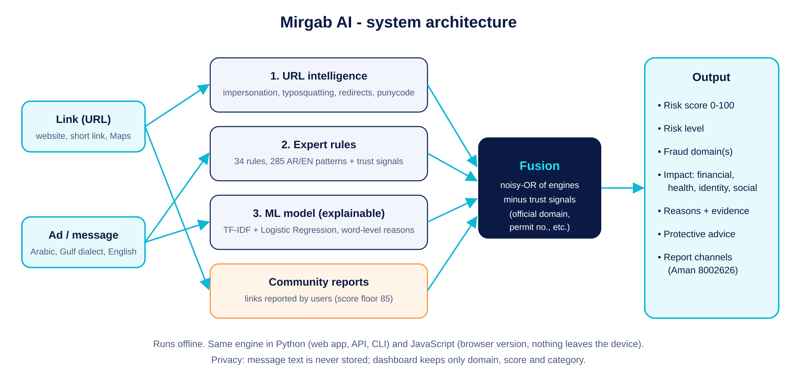
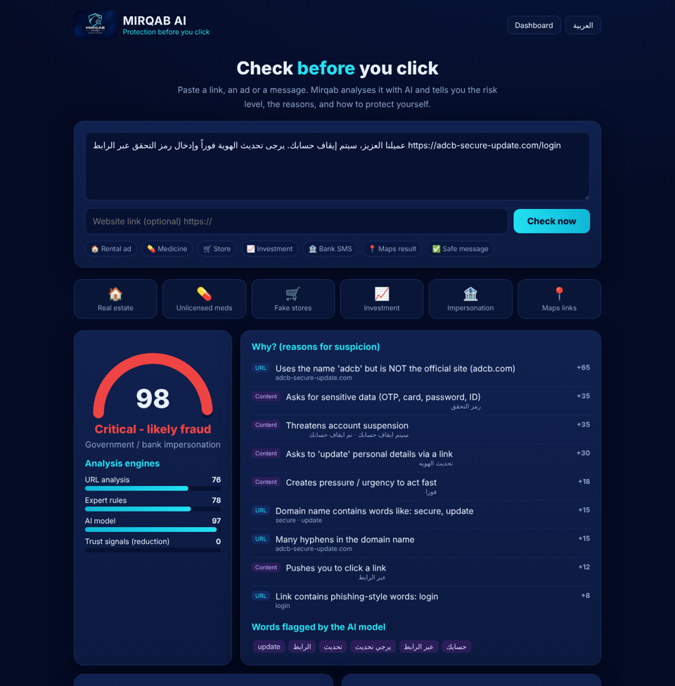
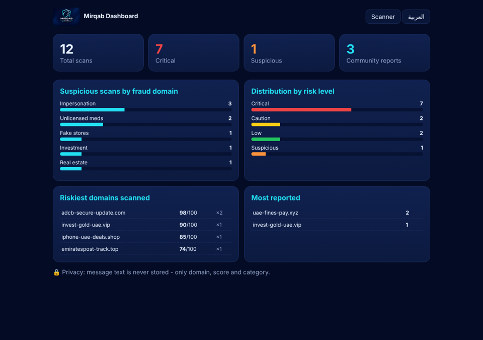

# 🇦🇪 MIRGAB AI | مِرقاب
**حمايتك قبل لا تضغط — Protection before you click**

An AI platform for the **early detection of online fraud in the UAE**. Paste a link, an ad or a message (Arabic, Gulf dialect or English) and Mirgab tells you in about 12 ms how risky it is, **why**, and what to do.

Built for the **Abu Dhabi Police × 42 Abu Dhabi Hackathon** by Team Mirgab:
Asma Alzaabi · Alyazeya Altamimi · Maitha Alkaabi · Mariam Alkarbi · Alanoud Almahri

- 🔗 **Live demo (no install):** https://claude.ai/artifact/FwcJppz3jaAYncjnLNRoq4
- 📘 **Technical documentation** (architecture, model choices, privacy design): [`docs/TECHNICAL_DOCUMENTATION.md`](docs/TECHNICAL_DOCUMENTATION.md)
- 🖥️ **Presentation:** `docs/Mirgab_AI_English.pptx` · `docs/Mirgab_AI_Arabic.pptx`



---

## 1. The problem
Online fraud in the UAE now looks official: fake links and ads in search results, fake trading platforms, and messages that impersonate banks and government entities. Abu Dhabi Police have repeatedly warned the public about these patterns. Most victims only discover the fraud **after they have paid**, and existing tools mostly check a single thing (is this URL on a blocklist?), in English, without explaining why.

## 2. Our solution
Mirgab checks **before the click**, across **six fraud domains**, in **Arabic and English**:

| | Domain | Examples of what Mirgab detects |
|---|---|---|
| 🏠 | Real estate | deposit before viewing, "owner abroad", no Ejari/Tawtheeq, unrealistic rent |
| 💊 | Unlicensed medicines | "no prescription", controlled drugs, miracle cures, slimming injections |
| 🛒 | Fake stores | 80–90% discounts, transfer-only payment, no refunds, replicas |
| 📈 | Investment | guaranteed returns, referral pyramids, crypto/forex hype |
| 🏦 | Gov / bank impersonation | look-alike domains, fake fines and parcels, OTP requests |
| 📍 | Google Maps links | hijacked "customer service" numbers and websites in listings |

For every input it returns:
- a **risk score (0–100)** and level
- the **fraud domain(s)**
- a **multi-dimensional impact profile**: financial · health · identity · social (a fake medicine is a health risk, not just a money risk)
- the **reasons, with evidence** (Explainable AI)
- **protective advice** and official **reporting channels** (Abu Dhabi Police Aman: 8002626 / SMS 2828)

It also includes **community reports** (a reported link is flagged for everyone) and an anonymised **dashboard for Abu Dhabi Police**.

| Result page | Police dashboard |
|---|---|
|  |  |

## 3. How to run it

**Option A — no install:** open the live demo link above.

**Option B — full app on your computer** (Python 3.10+):
```bash
git clone https://github.com/<your-username>/mirgab-ai.git
cd mirgab-ai
pip install -r requirements.txt
python app.py                 # open http://localhost:5000   (police dashboard: /dashboard)
```
The model trains itself on first run (a few seconds). You can also train it explicitly with `python train.py`.

> Windows: if `python`/`pip` aren't found, use `py` / `py -m pip`. On a Mac, use `python3` / `pip3`.
> Port 5000 busy (common on macOS)? Set the `PORT` environment variable, e.g. `PORT=5050 python app.py`.

**Other ways to use it**
```bash
pytest -q                                              # 25 automated tests
python evaluate.py                                     # prints the evaluation numbers below
python cli.py "https://adcb-secure-update.com/login"   # command line
python cli.py --lang ar --text "شقة 1000 درهم شهري، المالك مسافر، حول العربون"
cd web && python -m http.server 8000                   # browser-only version -> http://localhost:8000
```

**REST API**
| Method | Endpoint | Body | Returns |
|---|---|---|---|
| POST | `/api/analyze` | `{"text": "...", "url": "..."}` | full analysis (JSON) |
| POST | `/api/report` | `{"url": "...", "category": "..."}` | adds a community report |
| GET | `/api/stats` | – | anonymised dashboard data |

## 4. Reasoning behind our technical choices

| Choice | Why |
|---|---|
| **Three engines instead of one model** (URL intelligence + expert rules + ML) | Each catches what the others miss. URL tricks (typosquatting, hidden redirects) are structural, not textual. Rules encode UAE-specific knowledge we can't yet learn from data. ML generalises to new wording. A single strong signal is enough to raise the alarm (noisy-OR fusion). |
| **TF-IDF + Logistic Regression** for text | Works on Arabic and English together, trains in seconds, runs offline, and is **transparent**: every prediction breaks down into the words that pushed it up. That matters for police use and for user trust. With our current (small, synthetic) data, a deep model would not be more accurate, only harder to explain. |
| **Expert rules with Arabic normalisation** | 34 rules / 285 patterns, including Gulf dialect ("حول العربون", "ادفعها الحين"). We normalise hamza forms, ta marbuta and Arabic-Indic digits so spelling variants still match. |
| **Offline URL analysis** | No dependency on paid APIs or internet access; works for anyone, instantly. Live intelligence can be added later. |
| **Trust signals lower the score** | Official domains, permit numbers and "we never ask for your OTP" reduce risk, which keeps false alarms on real bank messages low. An official domain cancels *URL* risk but not *content* risk, because scammers often place a real bank link next to a fake phone number. |
| **Python + Flask + SQLite** | Simple, readable, easy for judges and future contributors to run anywhere. |
| **Same engine ported to JavaScript** (`web/`) | Lets anyone test from a link with **no server and no data leaving the device**. Verified identical scores to Python on 36 test cases. |
| **Privacy by design** | Message text is never stored. The dashboard keeps only domain, score and category. See the documentation. |

## 5. Evaluation (honest numbers)
- **ML model, synthetic hold-out split:** accuracy 1.00. This only shows the model learned the seed data. Train and test come from the same templates, so it is **not** a real-world benchmark.
- **Full engine, 18 hand-written realistic messages** (Arabic, Gulf dialect, English; 11 fraud / 7 legitimate): 18/18 correct fraud-vs-legit, and 11/11 assigned to the right fraud domain. The set is small and was used while adding dialect rules, so it is **not independent** either.
- **Speed:** about 12 ms per analysis on a laptop CPU.

Run `python evaluate.py` to reproduce these numbers.

## 6. Trade-offs we made
- **Explainability and speed over raw model power.** A transformer could understand more context, but it needs far more real data, a GPU or a paid API, and it is harder to explain.
- **Synthetic seed data over no model.** Real fraud reports were not available to us, so we generated bilingual training templates. The architecture is ready for real data (`data/extra_samples.csv` → `python train.py`).
- **Offline checks over live lookups.** We gave up domain-age, SSL and licence-registry checks so the prototype runs anywhere with no keys or internet.
- **Rule weights set by hand.** They are tuned by our judgement and tests, not learned. With real labelled data they should be calibrated.
- **Browser version feedback.** Visitors who aren't editors on the page can't save to it, so feedback falls back to a WhatsApp message.

## 7. What we left out
- Real, labelled fraud cases (the most important missing piece)
- Live domain age (WHOIS), SSL certificate and Google Safe Browsing checks
- Official licence registry look-ups (DoH pharmacies, SCA/DFSA/FSRA firms, ADREC brokers)
- Image and screenshot analysis (OCR of ad images)
- User accounts, authentication and rate limiting for a public deployment

## 8. What we would do with more time
1. **Real data first:** train and measure on anonymised cases (e.g. from Aman reports), with a proper held-out test set and calibrated thresholds.
2. **Arabic language model:** fine-tune AraBERT (or a similar model) for dialect understanding, keeping the explainable model as a fallback.
3. **Background protection app:** Mirgab running in the background on phones and computers. When the user opens an unsafe website, app or link, it shows an instant warning ("⚠️ Careful! This site may be fraudulent") with the reason, before they pay or enter data.
4. **Agentic AI:** an agent that visits suspicious sites in a sandbox, checks registries, links ads into fraud networks and writes case files for investigators.
5. **Reach users where they are:** WhatsApp bot ("forward it to Mirgab") and integration with the Abu Dhabi Police and TAMM apps.

In hindsight, we would have started collecting a small real (anonymised) test set on day one, so every design decision could be measured against it.

## 9. Project structure
```
mirgab/            Python engine
  config.py        knowledge base: 39 official domains, 26 brands, 34 bilingual rules, impact matrix
  text.py          Arabic normalisation, URL/phone extraction, rule detection
  url_analyzer.py  offline URL intelligence
  dataset.py       synthetic bilingual seed dataset
  model.py         ML classifier + word-level explanations
  engine.py        fusion, scoring, impact, advice
  advice.py        protective advice per domain (AR/EN)
  storage.py       SQLite: anonymised scan log + community reports
app.py             Flask web app + REST API
cli.py             command line
train.py           train / retrain the model
evaluate.py        reproduce the evaluation numbers
templates/         bilingual UI (RTL/LTR) + police dashboard
web/               browser-only version (JavaScript port, same results)
tests/             pytest suite (25 tests)
data/              realistic test set (+ optional extra_samples.csv)
docs/              technical documentation, diagram, screenshots, presentations
```

## 10. License
© 2026 Team Mirgab. All rights reserved. See [LICENSE](LICENSE).
