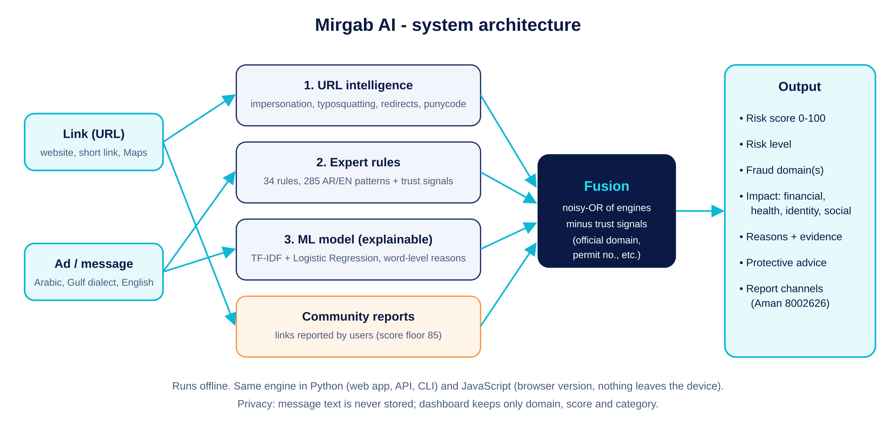

# MIRGAB AI | مِرقاب — Technical Documentation

**Proactive, multi-domain, explainable fraud detection for the UAE**
Abu Dhabi Police × 42 Abu Dhabi Hackathon · Version 0.1 (prototype) · November 2026

**Team Mirgab:** Asma Alzaabi · Alyazeya Altamimi · Maitha Alkaabi · Mariam Alkarbi · Alanoud Almahri

---

## Contents
1. Overview
2. Problem and goals
3. System architecture
4. The detection engines
5. Fusion, scoring and impact
6. Model choices and alternatives considered
7. Data
8. Evaluation
9. Explainability
10. Privacy design
11. Security
12. Interfaces (web app, API, CLI, browser version)
13. Limitations and trade-offs
14. Roadmap
15. Appendix: configuration and extension

---

## 1. Overview
Mirgab analyses a **link**, an **ad** or a **message** and returns, in about 12 ms on a laptop CPU:

| Output | Description |
|---|---|
| Risk score | 0–100 |
| Risk level | low (<25), caution (25–49), suspicious (50–74), critical (75+) |
| Fraud domain(s) | up to three, with their share of the evidence |
| Impact profile | financial, health, identity, social (0–100 each) |
| Reasons | every red flag and trust signal, with its weight and the evidence found |
| Advice | protective steps for the detected fraud type (Arabic and English) |
| Report channels | Abu Dhabi Police Aman 8002626 / SMS 2828, MOI eCrimes, your bank (shown when score ≥ 50) |

It runs **fully offline**, in Arabic (including Gulf dialect) and English, and the same engine exists in Python (web app, REST API, CLI) and JavaScript (browser-only version).

## 2. Problem and goals
Fraud has moved to channels that look official: search-engine ads and look-alike sites, fake investment platforms, and SMS/WhatsApp messages impersonating banks and government entities. Victims usually discover the fraud after paying.

**Goals**

1. **Proactive:** warn *before* the user clicks, pays or shares data.
2. **Multi-domain:** cover six fraud domains with one tool, not just phishing links.
3. **Multi-dimensional:** measure the harm (financial, health, identity, social), not just "fraud / not fraud".
4. **Explainable:** every score comes with human-readable reasons.
5. **UAE-specific and bilingual:** know local entities and banks; understand Arabic and Gulf dialect.
6. **Private by design:** do not collect what we don't need.

**Covered fraud domains:** real estate · unlicensed medicines · fake online stores · investment fraud · government/bank impersonation · fraudulent Google Maps listing links.

## 3. System architecture



**Data flow**

1. The input is split into **URLs** (extracted from the text or given separately) and **content** (the remaining text).
2. Each URL goes to **URL intelligence**. Its registered domain is also checked against **community reports**.
3. The content goes to the **expert rules** and the **ML model**.
4. **Fusion** combines the engine scores and applies **trust signals**, producing the risk score.
5. The fraud domain is chosen by **weighted votes** from all flags and the ML prediction. The **impact profile**, **reasons** and **advice** are derived from it.
6. In the Flask app, an **anonymised log row** (domain, score, level, category; never the text) is stored for the dashboard.

**Components** (`mirgab/` package)

| Module | Responsibility |
|---|---|
| `config.py` | Knowledge base: categories, 39 official domains, 26 brand keywords, suspicious TLDs, shorteners, 34 text rules (285 patterns), 4 trust rules, impact matrix, risk levels, reporting channels |
| `text.py` | Arabic/English normalisation, URL and phone extraction, rule matching |
| `url_analyzer.py` | Offline URL analysis |
| `dataset.py` | Synthetic bilingual seed dataset |
| `model.py` | TF-IDF + Logistic Regression training, prediction and explanation |
| `engine.py` | Fusion, category vote, impact, advice, output |
| `advice.py` | Protective advice per domain |
| `storage.py` | SQLite: anonymised scan log and community reports |

## 4. The detection engines

### 4.1 URL intelligence (`url_analyzer.py`)
Works without network access. A host is split into sub-domain, registered domain and suffix, with multi-part suffixes such as `gov.ae` and `co.ae` handled.

| Check | Weight | Example |
|---|---|---|
| Brand impersonation: a known brand keyword in a non-official domain | 0.65 | `adcb-secure-update.com` |
| Typosquatting: edit distance ≤ 1 (≤ 2 for long names) to an official domain, after homoglyph normalisation (0→o, 1→l, rn→m) | 0.55 | `adcbb.com`, `emiratesnb0.com` |
| Raw IP address host | 0.45 | `http://192.168.4.4/...` |
| Download of an app/executable | 0.40 | `.apk`, `.exe` |
| `@` in the address (real host hidden after it) | 0.40 | `user@evil.top` |
| Hidden open redirect inside a trusted domain; the inner URL is analysed recursively and the wrapper's trust is removed | 0.35 | `google.com/url?q=fake-site` |
| Punycode / internationalised domain | 0.35 | `xn--...` |
| Shortened link | 0.25 | `bit.ly/...` |
| Low-cost TLD often abused | 0.20 | `.xyz .top .vip .shop` |
| Phishing words in the domain or path | 0.15 / up to 0.25 | `secure`, `update`, `login`, `otp` |
| Many hyphens / digits / deep sub-domains, plain HTTP, odd port, very long URL | 0.08–0.15 | |

**Trust:** an exact match with one of the 39 official domains gives −0.45; any `.gov.ae` domain gives −0.35.

**Google Maps:** a Maps link is not suspicious in itself, but listings can carry hijacked phone numbers and websites. Mirgab therefore adds a low-weight `maps` flag, removes Google's trust and gives Maps-specific advice.

### 4.2 Expert rules (`text.py`, `config.py`)
34 rules across 7 groups (generic manipulation plus the six domains), 285 Arabic and English patterns, and 4 trust rules. Examples:

| Rule | Domain | Weight |
|---|---|---|
| Asks for OTP / card / password / ID number | generic | 0.35 |
| Untraceable payment (gift cards, USDT, personal account) | generic | 0.30 |
| Deposit before viewing (عربون قبل المعاينة، مبلغ الحجز) | real estate | 0.35 |
| Sells prescription medicine without a prescription (بدون وصفة) | medicines | 0.40 |
| Guaranteed returns / daily profit (أرباح مضمونة) | investment | 0.40 |
| Threatens account suspension (سيتم إيقاف حسابك) | impersonation | 0.35 |
| Unrealistic rent: villa/apartment under 1,500 AED per month (computed) | real estate | 0.25 |

**Arabic normalisation** before matching: remove diacritics and tatweel; أ/إ/آ/ٱ → ا; ة → ه; ى → ي; ؤ → و; ئ → ي; Arabic-Indic digits → 0–9; lower-case and collapse whitespace. English patterns use whole-word matching ("pin" does not match "shopping"); Arabic patterns use substring matching, which handles attached prefixes such as و and ال.

**Trust rules** (reduce risk): permit/licence numbers (RERA, Trakheesi), "prescription required", standard anti-fraud warnings ("we will never ask for your OTP"), and named regulators (SCA, DFSA, FSRA). When a message contains an anti-fraud warning, the "asks for OTP" flag is suppressed, because it is mentioning OTPs, not requesting one.

### 4.3 Machine-learning model (`model.py`)
- **Features:** TF-IDF over word unigrams and bigrams, on the same Arabic-normalised text; `min_df=2`, sublinear TF; 1,945 features.
- **Classifier:** multinomial Logistic Regression (`C=4`, balanced class weights) over 6 classes: legit, real_estate, pharma, fake_store, investment, impersonation.
- **Output:** fraud probability = 1 − P(legit); likely domain = the most probable fraud class.
- **Reliability gate:** the ML score is multiplied by min(1, matched features / 6), so the model has little say on text whose vocabulary it barely recognises.

## 5. Fusion, scoring and impact

**Engine scores** use noisy-OR within each engine: `S = 1 − Π(1 − wᵢ)`.

```
url_score  = noisy_or(URL + community flags) × (1 − min(2 × url_trust, 1))
rule_score = noisy_or(text rule flags)
ml_score   = P(fraud) × reliability
combined   = noisy_or(url_score, 0.9 × rule_score, 0.75 × ml_score)
combined  ×= 1 − min(text_trust + 0.3 × url_trust, 0.7)
score      = round(100 × combined)          # community-reported domain → at least 85
```

**Why noisy-OR:** independent evidence accumulates (two medium flags are worse than one), and a single strong signal is enough to raise the alarm, while the result stays bounded between 0 and 1.

**Why trust is split:** an official domain fully cancels URL risk but only slightly reduces content risk. Scammers often include a real bank link next to a fake phone number or an OTP request.

**Fraud domain:** each flag votes its weight for its domain; the ML model adds `P(fraud) × 0.6 × reliability` for its predicted domain. Up to three domains are reported with their share, which is what makes Mirgab *multi-domain*. A rental scam asking for card details shows both real estate and identity risk.

**Impact profile (multi-dimensional):** each domain has a harm profile, for example medicines = financial 0.50, **health 1.00**, identity 0.30, social 0.50. The output is the maximum over detected domains, weighted by each domain's share and scaled by the overall score. If sensitive data is requested, identity impact rises to at least 0.9.

## 6. Model choices and alternatives considered

| Option | Pros | Cons | Decision |
|---|---|---|---|
| Rules only | Transparent, no data needed | Brittle to new wording | **Used** as one engine |
| Blocklist / reputation APIs | Accurate for known sites | Misses new sites; needs internet and keys; URLs only | **Left out** for now (roadmap) |
| Naive Bayes | Very fast | Less accurate with correlated words; probabilities poorly calibrated | Rejected |
| Linear SVM | Accurate on text | No native probabilities (needed for fusion) | Rejected |
| **TF-IDF + Logistic Regression** | Fast, offline, bilingual, probabilistic, **explainable per word** | Bag-of-words: limited context | **Chosen** |
| Fine-tuned AraBERT / transformer | Understands context and dialect | Needs much more real data and a GPU; harder to explain; heavier to deploy | **Roadmap**, once real data exists |
| LLM API (prompting) | Flexible, no training | Sends user messages to a third party (privacy), cost, latency, non-deterministic | Rejected for privacy |

**Key reason:** with no real labelled data yet, a more complex model would not be measurably better, but it would be less explainable, less private and harder to deploy. The architecture keeps the model swappable: anything that returns P(class) and word contributions can replace it.

## 7. Data
- **Seed training set (synthetic):** 840 examples generated from bilingual templates in `dataset.py`: 120 per fraud class and 240 legitimate messages (bank notices, licensed pharmacies, real listings with permit numbers, everyday chat). Templates include Gulf dialect.
- **Realistic check set:** 18 hand-written messages in `data/realistic_test.csv`, written in different words from the templates.
- **Adding real data:** put rows in `data/extra_samples.csv` (`text,label`) and run `python train.py`. They are merged automatically. For the browser version, run `python web/export_data.py` afterwards.

## 8. Evaluation

| Test | Result | Caveat |
|---|---|---|
| ML model, synthetic 80/20 hold-out | accuracy 1.00, macro-F1 1.00 | Same templates in train and test: shows learning, not real-world accuracy |
| Full engine, 18 realistic messages (11 fraud, 7 legit) | 18/18 fraud-vs-legit (precision 1.00, recall 1.00); 11/11 correct domain | Small, and used while adding dialect rules: not independent |
| Scenario tests (pytest) | 25/25 pass | Covers all six domains, phishing URLs, official sites, trust signals, API, community reports |
| Python ↔ JavaScript parity | 36/36 identical scores and categories | |
| Speed | ~12 ms per analysis (laptop CPU) | |

**What a proper evaluation needs:** an independent, anonymised set of real reported cases plus legitimate messages, split by time (train on older, test on newer), reporting precision, recall and false-positive rate per domain, with thresholds calibrated on a validation set. Reproduce the current numbers with `python evaluate.py`.

## 9. Explainability
Every result lists:

- **Each red flag:** a plain-language reason in Arabic and English, its weight and the exact evidence (matched phrase or domain).
- **Each trust signal** and how much it lowered the score.
- **The words the ML model relied on:** contribution of word *j* = tfidfⱼ × (wⱼ,domain − wⱼ,legit).
- **The engine breakdown:** URL, expert rules, AI model, trust reduction.

This lets a user understand *why* they should be careful, and lets an investigator audit each decision. No black box.

## 10. Privacy design

| Principle | How Mirgab applies it |
|---|---|
| **Data minimisation** | The scan log stores only: timestamp, input type, registered domain, score, level, category. **Never the message text, phone numbers or full URLs.** |
| **On-device processing** | The browser version runs the whole engine in JavaScript. What the user pastes **never leaves the device**. No third-party APIs or LLMs receive user content. |
| **Purpose limitation** | Stored data is used only for aggregate trends on the police dashboard and for community reports. |
| **Consent for feedback** | Feedback includes the checked text only if the user ticks "include the text I checked" (shown clearly). Users are told not to paste passwords or card numbers. |
| **Anonymity** | No accounts, names or emails are needed to use Mirgab. Community reports store the domain and an optional short note (300 characters). |
| **Access control** | Feedback stored in the browser version is readable only by the page owner. |
| **Retention (planned)** | Scan logs older than a set period (e.g. 90 days) deleted automatically in production. |
| **Compliance** | Designed to align with the UAE Personal Data Protection Law (Federal Decree-Law No. 45 of 2021) and the hackathon's data protection terms; a production deployment would need a formal privacy impact assessment with Abu Dhabi Police. |

**Privacy-related choices:** we rejected sending messages to an external LLM API, and we do not commit the SQLite database or the trained model to the repository.

## 11. Security
- Input size limits: text ≤ 5,000 characters, URL ≤ 2,000.
- All output is HTML-escaped in the UI (prevents script injection from analysed content).
- SQLite access uses parameterised queries only.
- Mirgab never visits or downloads the URLs it analyses (no SSRF risk, no malware exposure).
- Official domains cannot be community-reported (prevents abuse against real entities).
- Production needs: HTTPS, rate limiting, authentication for the dashboard, abuse monitoring for reports.

## 12. Interfaces

| Interface | How |
|---|---|
| Web app (Flask) | `python app.py` → http://localhost:5000 ; dashboard at `/dashboard`. Bilingual RTL/LTR, mobile friendly. |
| REST API | `POST /api/analyze {text,url}` · `POST /api/report {url,category,note}` · `GET /api/stats` |
| CLI | `python cli.py [--lang ar] [--json] "<url or text>"` |
| Browser version | `web/` — static files, no server logic; live demo link in README |

## 13. Limitations and trade-offs
1. **Synthetic training data:** reported ML accuracy is optimistic; real data is the top priority.
2. **Hand-set rule weights:** reasonable but not statistically calibrated.
3. **Offline only:** no domain age, SSL, Safe Browsing or licence-registry checks yet.
4. **Bag-of-words ML:** limited understanding of context, sarcasm or very new wording.
5. **Possible false positives:** for example, legitimate sites whose names are one letter away from a bank's.
6. **Text only:** no analysis of images or screenshots of ads.
7. **Browser version feedback:** visitors who aren't editors on the page can't save feedback to it, so it falls back to WhatsApp.

## 14. Roadmap
1. **Real data:** anonymised, labelled cases from Abu Dhabi Police (e.g. Aman reports); a proper benchmark; calibrated thresholds; AraBERT for dialect.
2. **Background protection app:** Mirgab runs in the background on phones and computers, monitors websites, apps and links as they are opened, and shows an instant warning ("⚠️ Careful! This site may be fraudulent") with the reason, before the user pays or enters data.
3. **Live intelligence:** domain age, SSL certificate data, Safe Browsing, and official registries (licensed pharmacies, brokers, investment firms).
4. **Agentic AI investigator:** an agent that visits suspicious sites in a sandbox, collects evidence, links ads into fraud networks and drafts case files for investigators.
5. **Reach:** WhatsApp bot ("forward it to Mirgab"), integration with the Abu Dhabi Police app and TAMM.

## 15. Appendix: configuration and extension
- **Add an official domain or brand:** edit `OFFICIAL_DOMAINS` / `BRAND_KEYWORDS` in `config.py`.
- **Add a rule:** append `(id, category, weight, [patterns], english_reason, arabic_reason)` to `TEXT_RULES`.
- **Add training data:** `data/extra_samples.csv` → `python train.py` → `python web/export_data.py`.
- **Change risk thresholds:** `RISK_LEVELS` in `config.py`.
- **Environment variables:** `PORT` (web app port), `MIRGAB_DB` (SQLite path).
